<h1 align="center">¡Hola! Soy Gastón Alberto Cejas 👋</h1>

<h3 align="center">
  Desarrollador Junior · Estudiante UTN · Abogado orientado a LegalTech
</h3>

  Java · SQL · Python · FastAPI · React · TypeScript · PostgreSQL · Desarrollo Full Stack

  
  
  

  
  
  

---

## 👨‍💻 Sobre mí

Soy estudiante de la **Tecnicatura Universitaria en Programación de la Universidad Tecnológica Nacional**, actualmente cursando el segundo año (cuarto semestre). Me estoy formando en desarrollo de software, programación orientada a objetos, bases de datos, desarrollo web full stack, análisis de datos y metodologías de sistemas.

También soy **abogado, egresado en 2013**, y busco integrar mi experiencia profesional con la tecnología para desarrollarme en áreas como **backend, QA, análisis funcional y LegalTech**.

- 🔭 Busco incorporarme a equipos de **desarrollo, QA o análisis funcional**.
- 🌱 Actualmente profundizo en **Spring Boot, JPA, Hibernate, APIs REST, NoSQL y testing manual**.
- 🧩 Este semestre desarrollé aplicaciones **full stack**: APIs REST con **FastAPI + SQLModel + PostgreSQL** (autenticación JWT en cookie HttpOnly, roles, Unit of Work y transacciones) y SPAs con **React + TypeScript** (TanStack Query, Form y Table, Zustand y Tailwind CSS).
- ⚖️ Mi experiencia jurídica aporta análisis de casos, documentación, comunicación profesional, gestión de procesos y tratamiento responsable de información sensible.
- 🤖 Utilizo IA generativa como apoyo para programar, documentar, depurar y analizar soluciones, siempre con revisión manual, contraste técnico y control de versiones.
- 📍 Vivo en Córdoba Capital y cuento con disponibilidad presencial, híbrida o remota.

---

## 🛠️ Stack tecnológico

### Lenguajes y desarrollo web

  

### Backend, bases de datos y persistencia

  

  
  
  
  
  
  
  
  
  
  
  

### Frontend moderno

  

  
  
  
  
  
  
  

### Herramientas, metodologías y análisis

  

  
  
  
  
  
  
  
  
  
  

### Inteligencia artificial aplicada al desarrollo

  
  
  
  

> Uso estas herramientas para investigación, documentación, revisión de lógica, depuración, refactorización, consultas SQL, diseño de estructuras y preparación de pruebas. Valido manualmente las respuestas y adapto cada solución al contexto real del proyecto.

---

## 🚀 Proyectos destacados

### 🍔 Food Store full stack: sistema de pedidos de comida

**Python · FastAPI · SQLModel · PostgreSQL · JWT · React · TypeScript · TanStack · Zustand · Tailwind CSS**

Trabajo Práctico Integrador de Programación IV. Aplicación completa para un negocio de comidas: registro e inicio de sesión con JWT en cookie HttpOnly, catálogo paginado con búsqueda y filtros, carrito persistido, checkout y seguimiento de pedidos. Incluye un panel de administración con indicadores, ABM de categorías y productos, gestión de stock, máquina de estados de pedidos y administración de usuarios. Las compras se registran en una única transacción (Unit of Work) que descuenta y restituye el stock.

### 📦 Sistema de gestión de productos con código de barras

**Java · SQL · MySQL/MariaDB · JDBC · POO · Arquitectura por capas**

Aplicación académica para gestionar productos, categorías, stock, precios y códigos de barras. Incluye diseño de entidades, relaciones entre clases, validaciones, persistencia en base de datos y operaciones CRUD.

### 🛒 Food Store: tienda online académica

**HTML · CSS · JavaScript · TypeScript · Gradle · JPA · Hibernate · H2**

Proyecto orientado a la construcción de una interfaz web para presentar productos, categorías y navegación, con incorporación progresiva de lógica frontend y una implementación backend con persistencia.

### 🧮 Trabajo integrador: conjuntos matemáticos y programación

**Python · Jupyter Notebook · Condicionales · Ciclos · Funciones**

Trabajo práctico integrador sobre conjuntos, lógica, estructuras condicionales, estructuras repetitivas y funciones.

### 📊 Análisis estadístico aplicado

**R · RStudio · Estadística · Visualización de datos**

Procesamiento, organización e interpretación de datos; cálculo de medidas estadísticas; análisis de variables; distribuciones de probabilidad; inferencia y elaboración de gráficos.

  
<strong>Ver videos del proyecto</strong>

   

- [Puntos 3 y 4](https://www.youtube.com/watch?v=mRpH2pOiiqg&t=7s)
- [Distribuciones Binomial, Poisson y Normal](https://www.youtube.com/watch?v=qvc5PksK5jc)
- [Conceptos de inferencia estadística](https://www.youtube.com/watch?v=AwRiLZRz-F4)
- [Tablas de frecuencia en RStudio](https://www.youtube.com/watch?v=-EzcT9UDJXw)

### 🤖 Modelado de chatbot para atención al cliente

**BPMN · Herramientas No-Code · Análisis de procesos**

Modelado de un flujo de atención al cliente mediante procesos, decisiones, responsables y automatización conceptual.

### 🔎 Algoritmos de búsqueda y ordenamiento

**Python · Algoritmos · Estructuras de datos · Documentación**

Investigación aplicada sobre algoritmos de búsqueda y ordenamiento, análisis de eficiencia y organización de datos.

---

## 💼 Perfil profesional diferencial

Mi formación jurídica y tecnológica me permite abordar los proyectos desde una perspectiva integral:

- análisis de requerimientos y reglas de negocio;
- documentación clara, trazable y orientada a procesos;
- comunicación con usuarios y stakeholders;
- detección de inconsistencias y atención al detalle;
- manejo responsable de información sensible;
- comprensión de problemas complejos y explicación en lenguaje simple;
- interés especial en soluciones para **LegalTech, automatización documental y gestión de procesos**.

---

## 📈 Estadísticas de GitHub

  
  

 

  

> La tarjeta de lenguajes refleja el tamaño de los archivos públicos de los repositorios, no el nivel profesional alcanzado en cada tecnología.

---

## 🏆 Logros

  

---

## 👾 Gráfico de contribuciones

<picture>
  <source media="(prefers-color-scheme: dark)" srcset="https://raw.githubusercontent.com/GsuiteTdf/GsuiteTdf/output/pacman-contribution-graph-dark.svg">
  <source media="(prefers-color-scheme: light)" srcset="https://raw.githubusercontent.com/GsuiteTdf/GsuiteTdf/output/pacman-contribution-graph.svg">
  
</picture>

---

  <h3>🤝 Abierto a oportunidades de aprendizaje y colaboración</h3>
  

    Desarrollo junior · Backend · Full Stack · QA · Análisis funcional · LegalTech
  

  

